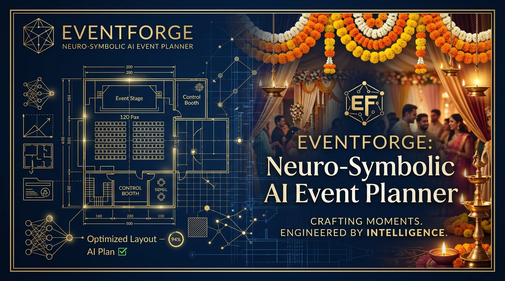
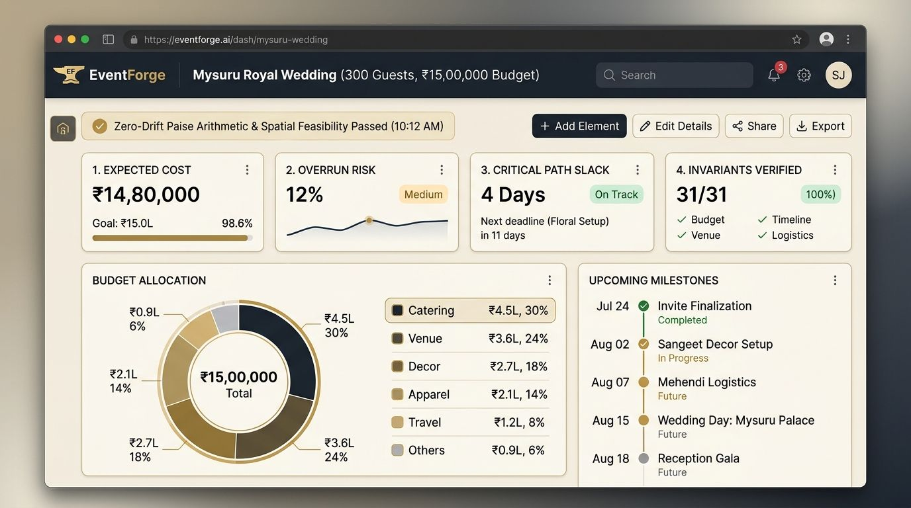
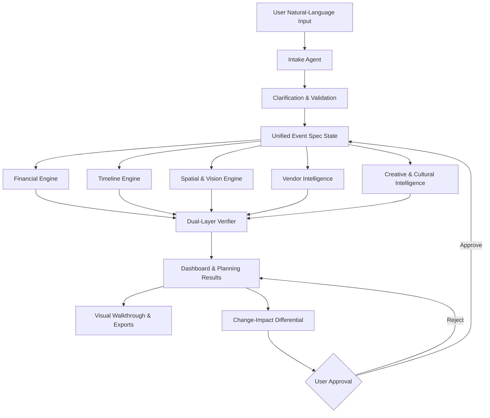
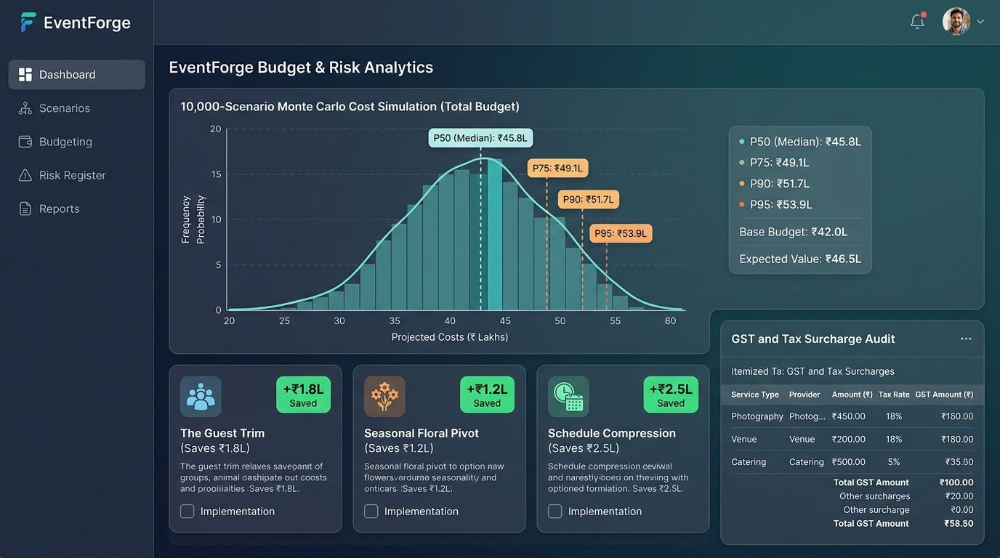
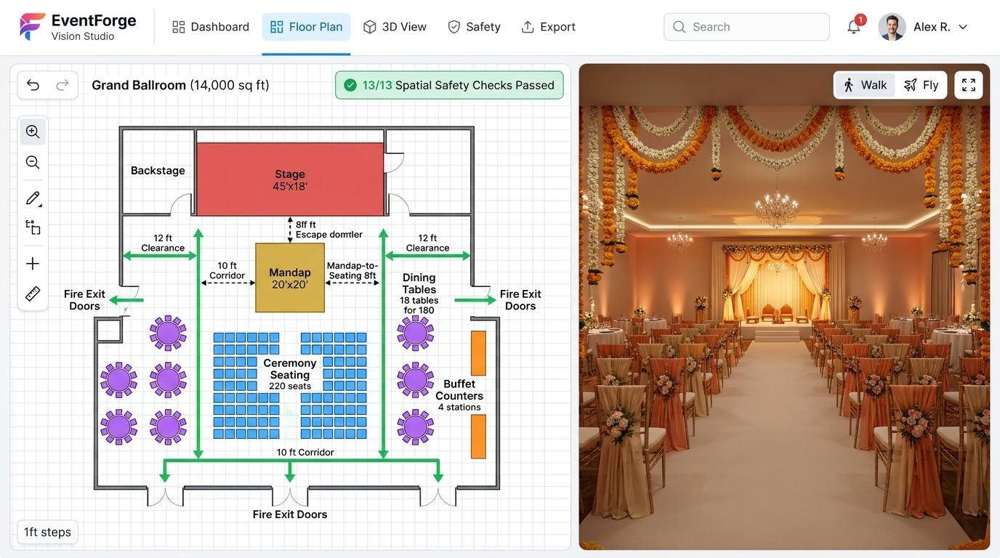
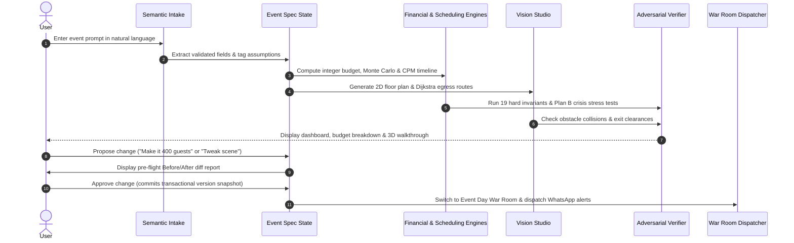

# EventForge — AI-Powered Event Planning & Decision Intelligence

> **Plan smarter. Spend confidently. Visualize before you commit.**

[](https://event-forge-taj8.vercel.app/)
[](https://github.com/somashekharvani/EventForge)
[](https://github.com/somashekharvani/EventForge#verification-and-testing)
[](LICENSE)

🚀 **Live Interactive Demo:** [https://event-forge-taj8.vercel.app/](https://event-forge-taj8.vercel.app/)



**EventForge** is a Neuro-Symbolic AI event planning platform designed for weddings, birthdays, and large-scale community events. It combines generative AI with deterministic algorithms to help users create event plans, manage budgets, schedule tasks, evaluate vendors, validate venue layouts, and preview how an event will flow before committing capital.

Unlike conventional chatbots that guess numbers and hallucinate dates, EventForge strictly separates AI-powered language understanding and creative inspiration from code-based calculations and geometric verification.

> **Core Philosophy:** *Let Generative AI handle conversation, semantic understanding, and creative inspiration. Let deterministic algorithms handle financial calculations, scheduling dependencies, and geometric validation.*

---

## Table of Contents
- [Overview](#overview)
- [Problem Statement](#problem-statement)
- [Our Solution: Neuro-Symbolic Architecture](#our-solution-neuro-symbolic-architecture)
- [System Architecture](#system-architecture)
- [Key Features](#key-features)
  - [1. Smart Intake & Event Specification](#1-smart-intake-and-event-specification)
  - [2. Deterministic Financial Engine & Pareto Optimizer](#2-deterministic-financial-engine--pareto-optimizer)
  - [3. Operations Research & Timeline Engine](#3-operations-research-and-timeline-engine)
  - [4. Vendor Intelligence & Contract Parsing](#4-vendor-intelligence--contract-parsing)
  - [5. Cultural & Dietary Protocol Intelligence](#5-cultural-and-dietary-protocol-intelligence)
  - [6. Adversarial Critic, Emergency Plan B & Judge Challenge](#6-adversarial-critic-emergency-plan-b--judge-challenge)
  - [7. Change-Impact Engine & Transactional Rollback](#7-change-impact-engine--transactional-rollback)
  - [8. Event Day War Room Dispatcher](#8-event-day-war-room-dispatcher)
- [EventForge Vision Studio](#eventforge-vision-studio)
- [Algorithms and Technical Innovation](#algorithms-and-technical-innovation)
- [Technology Stack](#technology-stack)
- [Event Planning Workflow](#event-planning-workflow)
- [Verification and Testing](#verification-and-testing)
- [Market Opportunity and Business Model](#market-opportunity-and-business-model)
- [Future Enhancements](#future-enhancements)
- [Responsible Use and Limitations](#responsible-use-and-limitations)
- [Getting Started](#getting-started)
- [Project Status & License](#project-status--license)

---

## Overview

EventForge transforms event planning into a structured, explainable, and interactive engineering process.

From an initial natural-language prompt to a verified event plan, the platform coordinates financial planning, operational scheduling, vendor intelligence, cultural personalization, venue visualization, and risk analysis through a single, shared event specification.



### Example Scenario
A user wants to organize a two-day traditional wedding in Mysuru, Karnataka, for 300 guests with a budget of ₹15,00,000.

EventForge assists the user end-to-end:
1. **Intake:** Converts free-form text into a validated event specification.
2. **Budgeting:** Generates a categorized budget with exact integer apportionment and contingency reserves.
3. **Scheduling:** Organizes tasks and deadlines using dependency-aware scheduling (Critical Path Method).
4. **Vendors:** Prepares checklists, ranks local vendors, and compares quotes.
5. **Traditions & Menus:** Suggests culturally tailored ceremonies (e.g., *Dhare Muhurtham*, *Saptapadi*), menus, and themes.
6. **Floor Plan Studio:** Validates room capacity and identifies geometric collisions or blocked fire doors.
7. **Interactive Changes:** Simulates changes (e.g., *"Make it 400 guests"*) with before-and-after diffs.
8. **Verification:** Validates hard invariants and models contingency stress tests.
9. **Walkthrough:** Provides a first-person planning preview with audio narration.

*(Note: All sample prices, simulated costs, and vendor ratings in the demo catalog are heuristic planning assumptions).*

---

## Problem Statement

Planning weddings, birthdays, and community gatherings involves coordinating dozens of tightly coupled, high-stakes decisions:
* **Financial Risk:** Budget misallocations, hidden GST taxes, and sudden cost overruns.
* **Spatial & Safety Hazards:** Overcrowded halls, blocked emergency exits, and acoustic interference.
* **Scheduling Collisions:** Complex multi-vendor workflows with circular dependencies and unrealistic lead times.
* **Cultural Nuances:** Traditional ceremony timelines, sacred ritual item requirements, and strict dietary segregation (e.g., Jain vegetarian requirements).
* **The "Chatbot Hallucination" Trap:** Standard LLMs frequently drop pennies on arithmetic, create impossible timelines, and guess dimensions.

EventForge solves these challenges through an integrated planning system with structured data, deterministic calculations, and explicit invariant verification.

---

## Our Solution: Neuro-Symbolic Architecture

EventForge combines **Generative AI** and **Deterministic Algorithms** into a unified, complementary system:

| Neural Intelligence (Generative AI) | Symbolic & Deterministic Intelligence (Code) |
| :--- | :--- |
| • Natural language intent extraction | • Exact integer-paise financial apportionment |
| • Contextual disambiguation & user clarification | • Hamilton-Hare largest-remainder allocation |
| • Creative theme styling & invitation drafting | • Directed Acyclic Graph (DAG) topological scheduling |
| • Cultural traditions & regional menu ideas | • Critical Path Method (CPM) slack & crashing |
| • Conversational explanation & audio narration | • Computational geometry & Dijkstra exit pathfinding |
| • Contextual risk observations | • Automated adversarial invariant verification (31/31) |

---

## System Architecture

The system revolves around a unified, validated Event Spec state machine. Every planning engine is a pure function of a slice of this state, enabling automatic cache invalidation and pre-flight change differential previews.



---

## Key Features

### 1. Smart Intake and Event Specification
Users describe their event in plain language instead of filling out exhausting multi-page forms.
* **Example:** *"My sister's wedding is in Mysuru in March, with around 300 guests, a ₹15 lakh budget, mostly vegetarian food, two days of celebrations, and no loud music."*
* **Structured Extraction:** Extracts event type, dates, guest counts, budget, diet, traditions, and priorities.
* **Explicit vs. Inferred:** Inferred defaults (like assuming the second Saturday of a month) are explicitly tagged (`date_assumed: true`), mandating user confirmation before bookings.
* **Zero-Cold-Start Fallback:** 100% operational offline without external API keys via regex/keyword deterministic extractors.

---

### 2. Deterministic Financial Engine & Pareto Optimizer
A structured, mathematically sound approach to event budgeting.



* **Integer-Paise Arithmetic:** All calculations use integer paise (1 Rupee = 100 paise) to eliminate IEEE-754 floating-point drift.
* **Hamilton-Hare Allocation:** Categories sum exactly to the budget total without rounding discrepancies.
* **10,000-Scenario Monte Carlo Simulation:** Vectorized NumPy simulation modeling correlated market volatility (log-normal shock) and guest attendance elasticity. Computes P50, P75, P90, P95, and variance attribution.
* **Pareto Multi-Strategy Optimizer:** Rather than vague advice, computes 3 distinct mathematical compromise strategies:
  1. *The Guest Trim:* Exact savings from scaling attendance by 15%, preserving premium catering/decor.
  2. *Seasonal Floral & Buffet Pivot:* Saves 20–25% by shifting to seasonal Marigold/Mango leaves + buffet service.
  3. *Schedule & Shift Compression:* Consolidates multi-day setups to eliminate duplicate venue rental days.
* **GST & Surcharge Auditor:** Audits statutory tax exposure (18% photography/venue/decor, 5% standalone catering, generator diesel, and municipal sound clearances) with explicit CA verification advisories.

---

### 3. Operations Research and Timeline Engine
Models event preparation as a Directed Acyclic Graph (DAG) with Kahn's topological sort.
* **Critical Path Method (CPM):** Computes Early/Late Start and Finish boundaries, total float, and free slack.
* **Infeasibility Detection:** If an event date is impossible, it reports the shortfall and calculates the **Earliest Feasible Date**.
* **Resource-Constrained Leveling:** Serial Schedule Generation Scheme (SGS) resolving coordinator capacity bottlenecks.
* **Export:** One-click sync to `.ics` calendar files and weekly digest summaries.

---

### 4. Vendor Intelligence & Contract Parsing
* **Multi-Criteria Scoring:** Transparent weighted ranking across budget fit, verified rating, distance, and availability.
* **Quote Discrepancy Extractor:** Extracts itemized prices, GST rates, and flags missing SLA or cancellation clauses.
* **Bilingual Outreach Generator:** Prepares tailored outreach messages in English and हिन्दी for WhatsApp and email.
* **Automatic Backup Allocation:** Maintains shortlisted backup options for critical categories.

---

### 5. Cultural and Dietary Protocol Intelligence
* **Regional Protocols:** Dedicated ceremony timelines and customs for:
  * **Kannada:** *Varapooje, Nandi, Dhare Muhurtham, Saptapadi, Banana-leaf Sadya.*
  * **North Indian / Punjabi:** *Mehendi, Sangeet, Haldi, Baraat & Milni, Jaimala, Pheras.*
  * **Tamil Brahmin:** *Nichayathartham, Oonjal, Kasi Yatra, Thali tying.*
  * **Marwari / Jain:** *Mayra/Bhaat, Mahila Sangeet, Toran reception, Lagna Mandap Pheras.*
* **Dietary Rigor:** Respectful enforcement for Jain menus (*strictly excludes root vegetables like potatoes, onions, and garlic, and enforces separate food preparation*).
* **Acoustic Comfort Zoning:** Heuristic comfort rule keeping elderly seating >10 m away from high-decibel speakers and DJ consoles.

---

### 6. Adversarial Critic, Emergency Plan B & Judge Challenge
* **19 Hard Invariants:** Pure code checks verifying budget sums, non-negative allocations, acyclic DAGs, capacity limits, obstacle clearances, and egress path distances.
* **Emergency Plan B Simulator:** Models resilience against 3 live crises:
  1. *Unseasonal Rainstorm:* Evaluates indoor protection vs. emergency waterproof pagoda canopy tenting.
  2. *Caterer Cancellation (48h Notice):* Verifies shortlisted backup availability, estimated price delta, and reopens procurement.
  3. *Guest Surge (+25% Attendance):* Evaluates catering cost increases and verifies exit door width sufficiency.
* **Hackathon Judge Challenge:** Adversarial testing harness with 3 extreme presets (*The Budget Black Hole*, *The Fire Code Hazard*, *The Impossible Timeline*) showing mathematical proofs of failure and verifier interventions.

---

### 7. Change-Impact Engine & Transactional Rollback
* **Pre-Flight Differential AST:** Proposing a change (e.g. *"Make it 400 guests"*) triggers an incremental recompute and outputs a detailed before/after diff (cost diff, moved tasks, broken layout checks).
* **Lossless Version Control:** Every committed action creates a version snapshot with instantaneous **Undo**, **Redo**, or **Restore**.

---

### 8. Event Day War Room Dispatcher
* **Live Operational Dashboard:** One-tap toggle from planning CAD to mobile-friendly day-of-event execution.
* **Next Milestone Radar:** Displays upcoming ceremony countdowns, locations, and expected attendees.
* **1-Tap WhatsApp Alerts:** Instant pre-filled `https://wa.me/?text=...` alerts for caterers, photographers, and sound technicians requiring zero API keys.
* **Hourly Run-of-Show Checklist:** Real-time sign-off sheet for coordinators and family leads.

---

## EventForge Vision Studio

EventForge Vision is the spatial planning and visual rehearsal component of the platform.



### 1. Structured Venue Model
* **Venue Library:** AC Banquet Hall, Garden Lawn, Kalyana Mantapa, Community Ground, Rooftop Terrace.
* **Custom Dimensions:** Allows entering exact meters (width × depth) with scaled door patterns.

### 2. Computational Geometry & Dijkstra Egress
* **Safety Rules:** 13 physical constraints covering obstacle collisions, minimum fire exit approach clearance (1.8 m buffer), noise buffer zones, and area-per-guest density thresholds.
* **Dijkstra Evacuation Solver:** Discretizes the floor plan into a 0.5-metre grid and runs Dijkstra's algorithm to compute actual evacuation path lengths (≤ 30.0 m maximum travel distance).

### 3. Planning Preview with Voice Narration
* **Raycasted Canvas Walkthrough:** Client-side first-person walkthrough with dynamic lighting matching the schedule (morning, afternoon, golden hour, evening party).
* **Web Speech Audio Narration:** Browser-native speech synthesis automatically narrating schedule milestones and spatial safety clearances aloud.
* **"Tweak This Scene" Action Surface:** Quick buttons to modify layout coordinates directly beneath the player.
* **Export:** One-click client-side WebM video recording and server-side animated GIF export.

*(Disclaimer: Planning preview — not an exact representation of the venue. Dimensions are based on user-entered specifications and planning heuristics, not statutory architectural certifications).*

---

## Algorithms and Technical Innovation

| Domain | Algorithm / Method | Engineering Purpose | Invariant Guaranteed |
| :--- | :--- | :--- | :--- |
| **Finance** | Hamilton–Hare Largest Remainder | Apportion budget across 10 categories | Sum of allocations + contingency = budget in whole paise |
| **Risk** | 10,000-run Monte Carlo Simulation | Vectorized cost uncertainty modeling | Correlated log-normal shock & attendance elasticity |
| **Scheduling** | DAG with Kahn's Topological Sort | Dependency ordering & cycle detection | Acyclic graph guarantee (Indegree = 0) |
| **Operations** | Critical Path Method (CPM) | Early/Late boundaries & slack analysis | Earliest Feasible Date calculation; non-negative slack |
| **Resource** | Serial Schedule Generation Scheme (SGS) | Multi-task coordinator capacity leveling | Daily coordinator effort <= 100% |
| **Spatial** | Computational Geometry Solvers | Collision detection & door clearances | Zero bounding-box overlaps; 1.8m exit corridors |
| **Safety** | Discretized 2D Dijkstra Pathfinding | Real evacuation walking distance | Walkable evacuation path <= 30.0 m to exit |
| **Optimization** | Pareto Multi-Strategy Trade-offs | Systematic budget deficit reduction | Cost savings quantified against explicit compromises |
| **Verification** | Metamorphic Fault-Injection Testing | Catch hallucinated or invalid plans | Verifier intercepts 100% of seeded adversarial plans |
| **State** | Differential AST-style Recomputation | Incremental dependency graph caching | Pre-flight before/after diff with lossless rollback |

---

## Technology Stack

* **Backend Framework:** Python 3.10+, Starlette (ASGI core), Uvicorn.
* **Data Validation & Schemas:** Pydantic v2.
* **Mathematical & Statistical Engines:** NumPy (vectorized Monte Carlo), Python integer arithmetic.
* **Graph & Operations Research:** Native DAG Kahn's solver, Critical Path Method (CPM), Serial SGS scheduler.
* **Spatial & Image Processing:** Pillow (PIL), Computational Geometry 2D matrix solvers.
* **Document & Report Generation:** ReportLab (vector PDF generation), iCalendar (.ics generator).
* **Database & Persistence:** SQLite3 (pure transactional JSON state snapshots).
* **Frontend Architecture:** Vanilla JavaScript (ES6+), HTML5 Canvas, SVG vectors, CSS Variables (zero external heavy framework dependencies, zero CDN reliance).
* **Audio & Media:** Web Speech API (`window.speechSynthesis`), MediaRecorder API (WebM video recording).

---

## Event Planning Workflow



---

## Verification and Testing

EventForge includes a built-in evaluation harness that runs directly inside the application (**Verify tab**) or via terminal commands.

### Evaluation Suite Summary (31 / 31 Passed)
* **Group A: Invariants (Property-style tests):**
  * Exact paise summation across 200 random weight sets.
  * Budget reconciliation across 40 randomized event specifications.
  * Monte Carlo monotonicity (higher budget strictly reduces overrun probability).
  * Monotonic what-if cost curves (adding guests never reduces expected cost).
  * Topological DAG execution order across all 3 event types and 30 dates.
  * Pareto optimizer invariant (3 distinct strategies with positive savings).
  * Statutory tax audit verification (18% photography/venue/decor, 5% catering).
* **Group B: Seeded Fault Injections (Deliberate attacks caught by verifier):**
  * Infeasible date detected and earliest feasible date reported.
  * Under-funded budget detected and flagged infeasible.
  * Overlapping layout elements detected.
  * Blocked fire exit doors caught with coordinate vectors.
  * Undersized venue rejected based on guest density.
  * Stage double-booking conflicts intercepted.
  * Insufficient turnover duration between ceremony and lunch caught.
  * Quotes with missing GST or missing cancellation policies flagged.
* **Group C: Behavioral & End-to-End Tests:**
  * Intake parser disambiguation and assumption tagging.
  * Propose -> apply -> undo state rollback integrity.
  * Full-coverage volunteer load leveling.
  * Emergency Plan B crisis simulations (Rainstorm, Caterer drop, Guest surge).

To run the full test suite locally:
```powershell
python -c "import sys; sys.path.insert(0, 'backend'); from engines.evals import run_all; res = run_all(); print('Passed:', res['passed'], '/', res['total']); assert res['passed'] == res['total']"
```

---

## Market Opportunity and Business Model

### The Market Crisis
* **$50 Billion+ Market:** India's wedding and event sector is among the largest in the world.
* **High Emotional & Financial Stakes:** Average families invest significant savings into a single celebration.
* **The Coordination Void:** Currently managed through disorganized WhatsApp chats, paper notes, and static Excel sheets, leading to budget inflation and last-minute logistical chaos.

### Commercialization Vectors
1. **B2C Freemium SaaS:** Free planning tier with monetization on premium branded PDF report exports, customized 3D venue renders, and multi-coordinator sync.
2. **B2B Venue & Banquet Software:** Banquets and kalyana mantapas license EventForge to offer certified digital twins, interactive table arrangements, and safety compliance reports to booking clients.
3. **Vendor Marketplace Commission:** Generating transaction fees on verified vendor bookings, contracts, and milestone-based escrow payments.

---

## Future Enhancements

* **Mobile LiDAR / AR Room Scanning:** Walk through an empty hall with an iPhone/Android device to automatically mesh room boundaries, pillars, and exit doors directly into Vision Studio.
* **AI Autonomous Negotiation Agent:** Automated voice/chat agent that contacts shortlisted vendors to confirm availability, request quotation PDFs, and negotiate within budget allocations.
* **Live Guest RSVP & Seating Companion App:** Mobile portal for attendees to confirm dietary requirements (e.g., Jain, vegan), view personalized table numbers, and receive ceremony alerts.
* **Smart Escrow Contracts:** Milestone-based payment releases tied to verified completion of timeline tasks.

---

## Responsible Use and Limitations

* **Estimates, Not Quotations:** Vendor catalogs, baseline costs, and Monte Carlo curves are planning heuristics based on city tiers and seasonality. Real-world vendor quotations must replace them as received.
* **Planning Previews, Not CAD Scans:** The 3D walkthrough and 2D floor plans are design aids based on user-entered dimensions. They do not replace on-site physical measurements or certified municipal fire clearance inspections.
* **Tax Advisory:** Tax calculations reflect standard rates (18% GST for services/rentals, 5% for standalone catering). Users must verify invoice details with qualified chartered accountants.
* **Deterministic Privacy:** Runs 100% locally on your machine with zero external data transmission required in deterministic mode.

---

## Getting Started

### 🌐 Instant Live Cloud Access (No Setup Required)
Open the deployed application directly in your browser:
👉 **[https://event-forge-taj8.vercel.app/](https://event-forge-taj8.vercel.app/)**

---

### Local Development Setup

#### Prerequisites
* **Operating System:** Windows, macOS, or Linux.
* **Python:** Version 3.10 or newer (ensure *"Add Python to PATH"* is enabled during installation).
* **Web Browser:** Google Chrome, Microsoft Edge, Safari, or Firefox.

#### Installation
1. Clone the project repository:
   ```powershell
   git clone https://github.com/somashekharvani/EventForge.git
   cd EventForge
   ```
2. Install Python dependencies:
   ```powershell
   pip install -r requirements.txt
   ```

### Running the Application
1. Start the backend server:
   ```powershell
   cd backend
   python -m uvicorn app:app --port 8000
   ```
2. Open your browser and navigate to:
   ```
   http://localhost:8000
   ```

### 60-Second Quick Demo Flow
1. Click the **"Mysuru wedding"** sample -> Click **Build my plan**.
2. Open **Verify** -> Click **💥 1. The Budget Black Hole** under **Hackathon Judge Challenge**, then click **Run evaluation suite** (all 31 pass).
3. Open **Budget** -> Inspect the **Pareto Strategy Cards** and **GST & Surcharge Audit**.
4. Open **Vision Studio** -> Toggle **🔊 Narration: ON** and click **Play** -> Click **"Move dining away"** under **Tweak this scene** to observe the before/after change preview.
5. Open **Overview** -> Toggle **⚡ Switch to Event Day War Room** to see the live milestone countdown and 1-tap WhatsApp vendor dispatch links.

---

## Project Status & License

* **Project Status:** Production-ready Hackathon MVP. 31/31 evaluation cases passing. Full deterministic offline execution enabled.
* **License:** [MIT License](LICENSE) — Open source for personal and educational use.
